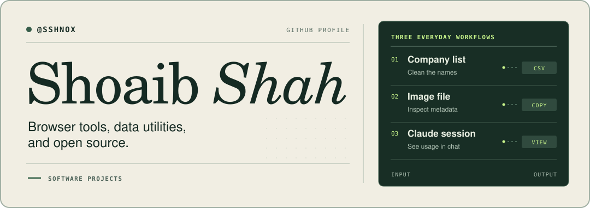
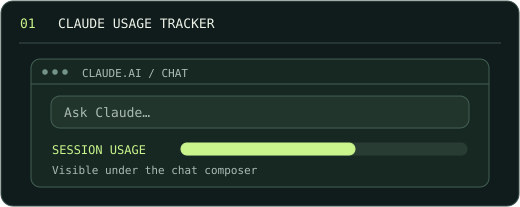
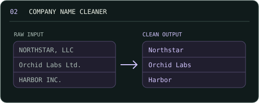
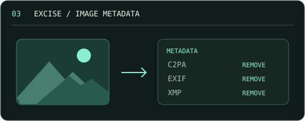
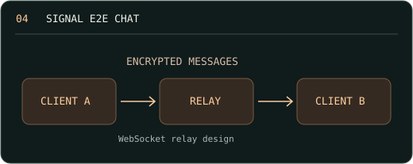
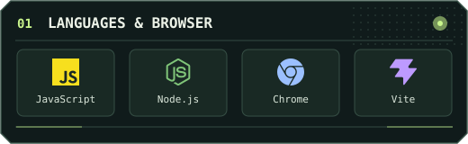
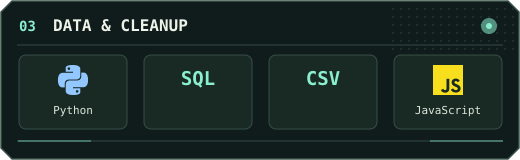
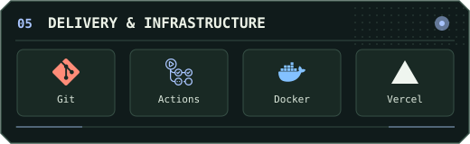
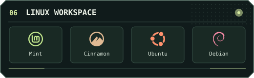

[**About**](#about) &nbsp;·&nbsp; [**Merged upstream**](#merged-upstream) &nbsp;·&nbsp; [**Projects**](#projects) &nbsp;·&nbsp; [**Toolkit**](#toolkit) &nbsp;·&nbsp; [**Stats**](#github-stats) &nbsp;·&nbsp; [**Contribution activity**](#contribution-activity) &nbsp;·&nbsp; [**Get in touch ↗**](https://linkedin.com/in/sshnox)

## About

I build browser tools and data utilities. Company Name Cleaner helps review and normalize names before export. Claude Usage Tracker shows usage limits inside the chat, and Excise strips image metadata locally. [Explore the projects](#projects).

When I contribute upstream, I like fixes where you can see the difference in one example. A mistyped CLI flag should tell CI the command was invalid. A knowledge graph node should keep the source text you need to expand it. [See the merged changes](#merged-upstream).

## Merged upstream

**12 merged PRs across 11 projects in the past 12 months.** Each link goes to the upstream PR.

| Project | Stars | What changed |
| :--- | ---: | :--- |
| **jc** | 8,703 | [Preserved leading whitespace in filenames parsed from `wc` output.](https://github.com/kellyjonbrazil/jc/pull/902) |
| **petl** | 1,325 | [Preserved existing rows when appending to a MemorySource.](https://github.com/petl-developers/petl/pull/796) |
| **Azure RBAC Insight** | 0 | [Kept assignments with missing filter labels visible.](https://github.com/chinmaymjog/azure-rbac-insight/pull/6) |
| **Awesome LLM Apps** | 144,399 | [Retained uploads when extraction fails.](https://github.com/Shubhamsaboo/awesome-llm-apps/pull/1281) [Preserved source text for Knowledge Explorer node expansion.](https://github.com/Shubhamsaboo/awesome-llm-apps/pull/1282) |
| **Pidrang** | 2 | [Kept environment setup reminders visible on reruns.](https://github.com/pidrang/pidrang/pull/197) |
| **R2G Arango** | 5 | [Restored distinct value sampling for CSV columns.](https://github.com/arango-solutions-org/r2g-arango/pull/71) |
| **Archy** | 8 | [Assembled call graph edges in linear time.](https://github.com/hslee16/Archy/pull/840) |
| **CWTools VSCode** | 3 | [Quoted carriage returns in CSV diagnostics.](https://github.com/MillenniumDawn/cwtools-vscode/pull/1280) |
| **domq** | 11 | [Validated Markdown options in either flag order.](https://github.com/iamsaquib8/domq/pull/171) |
| **Releaseproof** | 0 | [Returned the correct exit code for invalid CLI usage.](https://github.com/ujjwalv01/releaseproof/pull/156) |
| **Go Magnetar** | 29 | [Listed enabled agents when `/agent` is called without arguments.](https://github.com/wmentor/go-magnetar/pull/283) |

## Projects

<table>
<tr>
<td width="50%" valign="top">

### Claude Usage Tracker

See your limits under the Claude chat composer without leaving the conversation.

[**Install from source ↗**](https://github.com/sshnox/Claude-Usage-Tracker-v2.1.0#install) &nbsp;·&nbsp; [Source](https://github.com/sshnox/Claude-Usage-Tracker-v2.1.0/tree/main/src)

See the widget

<picture>
  <source media="(prefers-color-scheme: dark)" srcset="https://raw.githubusercontent.com/sshnox/Claude-Usage-Tracker-v2.1.0/3fecb07273795c9794c86f9854b8ee67ec13d0b2/docs/screenshots/widget-dark.png" />
  
</picture>

Load the `src` folder as an unpacked Chromium extension, then open Claude. The widget uses your active session.

</td>
<td width="50%" valign="top">

### Company Name Cleaner

Clean company names in the browser before importing a list into your CRM.

[**Try it in your browser ↗**](https://sshnox.github.io/company-name-cleaner/) &nbsp;·&nbsp; [Source](https://github.com/sshnox/company-name-cleaner)

Try a sample CSV

Open the app and import the [sample CSV](https://github.com/sshnox/company-name-cleaner/blob/644a20f6f9ccf222e49d90ffcbc6a060124b2fa6/examples/companies.csv). Set the company column to **2** and select **First row is a header**. Review the results before exporting.

With the default settings, `Müller GmbH` becomes `Müller`, and `شاہ ٹیکنالوجیز` stays as entered.

</td>
</tr>
<tr>
<td width="50%" valign="top">

### Excise

Remove C2PA, EXIF, and XMP data from images before sharing them.

[**Open the tool ↗**](https://sshnox.github.io/excise/) &nbsp;·&nbsp; [Source](https://github.com/sshnox/excise)

What happens to the image?

The app inspects the file in your browser and shows which metadata it finds. Choose what to remove, then download the processed copy. The file stays on your device.

</td>
<td width="50%" valign="top">

### Signal E2E Chat

An experiment in end-to-end encrypted messaging.

[**Run it locally ↗**](https://github.com/sshnox/Signal-e2e-chat#run-it-locally) &nbsp;·&nbsp; [Source](https://github.com/sshnox/Signal-e2e-chat)

Try a two-client session

Use Node.js 20 or later to start the relay and open two clients in separate terminals. Exchange a message and compare safety numbers. The repository also includes a local handshake and ratchet demo.

</td>
</tr>
</table>

[Browse all repositories ↗](https://github.com/sshnox?tab=repositories)

## Toolkit
A focused stack for browser utilities, data cleanup, and small open-source fixes.
<table>
<tr>
<td width="50%" valign="top">

### Browser tools
JavaScript, TypeScript, React, Vite, HTML/CSS, and Chrome Extensions for small utilities people can use immediately.
[Claude Usage Tracker ↗](https://github.com/sshnox/Claude-Usage-Tracker-v2.1.0)
</td>
<td width="50%" valign="top">

### Data utilities
Python, SQL, CSV, and client-side processing for normalization, extraction, and privacy-conscious workflows.
[Company Name Cleaner ↗](https://github.com/sshnox/company-name-cleaner)
</td>
</tr>
<tr>
<td width="50%" valign="top">

### Delivery & open source
Git, GitHub Actions, Docker, Vercel, and CLI tooling for repeatable checks, releases, and contributions.
[GitHub Stats ↗](https://github.com/sshnox/github-stats)
</td>
<td width="50%" valign="top">

### Working style
Prefer local-first tools, visible proof, small focused fixes, and documentation that shows the result in one example.
</td>
</tr>
</table>

## GitHub stats

[Open GitHub profile ↗](https://github.com/sshnox) &nbsp;·&nbsp; [View merged PRs ↗](https://github.com/pulls?q=is%3Apr+is%3Amerged+is%3Apublic+author%3Asshnox+-user%3Asshnox)

Account stats refresh hourly. Merges are counted over the trailing 12 months. Profile views count badge requests on pages where the badge appears.

## Contribution activity
<picture>
  <source media="(prefers-color-scheme: dark)" srcset="https://raw.githubusercontent.com/sshnox/sshnox/output/snake-dark.svg" />
  
</picture>

## Get in touch

**What’s one task you’re tired of doing by hand?**

[**Message me on LinkedIn ↗**](https://linkedin.com/in/sshnox)
