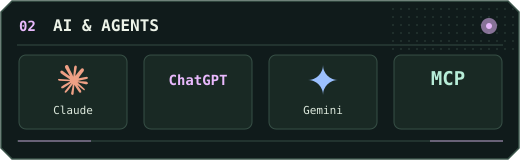
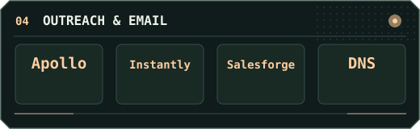

[**Merged upstream**](#merged-upstream) &nbsp;·&nbsp; [**Projects**](#projects) &nbsp;·&nbsp; [**Toolkit**](#toolkit) &nbsp;·&nbsp; [**Activity**](#activity) &nbsp;·&nbsp; [**Get in touch ↗**](https://linkedin.com/in/sshnox)

I like building tools that take a step out of someone’s day. That might mean cleaning a company list before a CRM import, checking Claude usage without leaving the chat, or stripping metadata from an image before sharing it.

## Merged upstream

| Project | What changed | Merged |
| :--- | :--- | :--- |
| **Releaseproof** | [Invalid CLI usage now exits with code 2, so a typo can’t look like a release mismatch in CI.](https://github.com/ujjwalv01/releaseproof/pull/156) | Nov 6, 2026 |
| **Awesome LLM Apps** | [Knowledge Explorer keeps the full source text available when expanding a graph node.](https://github.com/Shubhamsaboo/awesome-llm-apps/pull/1282) | Nov 6, 2026 |
| **Go Magnetar** | [Running `/agent` without arguments now shows the enabled agents.](https://github.com/wmentor/go-magnetar/pull/283) | Nov 4, 2026 |

## Projects

<table>
<tr>
<td width="50%" valign="top">

### Claude Usage Tracker

See your limits under the Claude chat composer without leaving the conversation.

[**Install from source ↗**](https://github.com/sshnox/Claude-Usage-Tracker-v2.1.0#readme)

How it works

The Chrome extension uses the active Claude session. It doesn’t ask you to paste a session token or supply an API key.

</td>
<td width="50%" valign="top">

### Company Name Cleaner

Clean company names in the browser before importing a list into your CRM.

[**View repository ↗**](https://github.com/sshnox/company-name-cleaner)

Where it fits

Use it between collecting a company list and importing the records into a CRM or outreach tool.

</td>
</tr>
<tr>
<td width="50%" valign="top">

### Excise

Remove C2PA, EXIF, and XMP data from images before sharing them.

[**Open the tool ↗**](https://sshnox.github.io/excise/) &nbsp;·&nbsp; [Source](https://github.com/sshnox/excise)

Where it fits

Useful when a photo’s metadata may reveal a location, a device, or editing information you’d prefer to keep private.

</td>
<td width="50%" valign="top">

### Signal E2E Chat

An experiment in end-to-end encrypted messaging.

[**Explore the code ↗**](https://github.com/sshnox/Signal-e2e-chat)

What’s inside

Session setup, ratcheting, safety numbers, and a WebSocket relay.

</td>
</tr>
</table>

[Browse all repositories ↗](https://github.com/sshnox?tab=repositories)

## Toolkit

The tools I use to build software, clean data, and run outreach.

<table>
<tr>
<td width="50%" valign="top">

### Languages & browser

Build browser utilities and extensions, then wire up the bits that need a server.

JavaScript, Node.js, React, HTML/CSS, Chrome Extensions, Vite.

[Claude Usage Tracker ↗](https://github.com/sshnox/Claude-Usage-Tracker-v2.1.0)

</td>
<td width="50%" valign="top">

### AI & agents

Work through code, research, and tool-connected workflows.

Claude, Claude Code, Claude Desktop, ChatGPT, Codex CLI, Gemini, Google AI Studio, MCP.

Also in the workspace: Antigravity and Manus.

</td>
</tr>
<tr>
<td width="50%" valign="top">

### Data & cleanup

Normalize names, remove duplicates, and prepare data for CRM and outreach imports.

Python, SQL, CSV, client-side JavaScript.

[Company Name Cleaner ↗](https://github.com/sshnox/company-name-cleaner)

</td>
<td width="50%" valign="top">

### Outreach & email

Source and clean prospect lists, set up sending domains and mailboxes, and track campaign performance.

Apollo, Instantly, Salesforge, Google Workspace, Microsoft 365.

Deliverability: SPF, DKIM, DMARC, and inbox placement.

</td>
</tr>
<tr>
<td width="50%" valign="top">

### Delivery & infrastructure

Version code, run checks, and deploy tools people can try.

Git, GitHub, GitHub Actions, Docker, Vercel, Go contributions.

[Contribution animation workflow ↗](https://github.com/sshnox/github-profile/blob/main/.github/workflows/contribution-animation.yml) · [Go Magnetar ↗](https://github.com/wmentor/go-magnetar/pull/283)

</td>
<td width="50%" valign="top">

### Linux workspace

Desktop and terminal environments for building and testing.

Linux Mint, Cinnamon, Ubuntu, Debian.

</td>
</tr>
</table>

## Activity

<picture>
  <source media="(prefers-color-scheme: dark)" srcset="https://raw.githubusercontent.com/sshnox/github-profile/output/snake-dark.svg" />
  
</picture>

## Get in touch

**What’s one task you’re tired of doing by hand?**

[**Message me on LinkedIn ↗**](https://linkedin.com/in/sshnox) &nbsp;·&nbsp; [Visit my site ↗](https://shoaibshah.com)
